<div align="center">

<!-- ========================================================================= -->
<!--                      🎮 HUD // HERO DISPLAY SCREEN                        -->
<!-- ========================================================================= -->

<a href="https://devanshsingh.dev" target="_blank" rel="noopener noreferrer">
  
</a>

<br/>

<!-- DYNAMIC TYPING TELEMETRY -->
<a href="https://git.io/typing-svg">
  
</a>

</div>

---

<!-- ========================================================================= -->
<!--                      ⚔️ OPERATOR / ARCHITECT SPEC                         -->
<!-- ========================================================================= -->

```yaml
operator_profile:
  callsign: "Devansh Singh Rajput"
  classification: "ML Systems Architect & Data Analytics Engineer"
  institution: "SRM-IST Delhi-NCR (B.Tech CSE '27) · CGPA 8.91"
  research_station: "Ex-Research Intern @ IIT(ISM) Dhanbad (Tenure Completed)"
  level: 27  # Defined by B.Tech CSE Class of 2027 (Undergrad Milestone)

latest_completed_dispatch:
  mission_id: "olist-delivery-analysis"
  repository: "https://github.com/DevanshSrajput/olist-delivery-analysis"
  dashboard: "https://public.tableau.com/app/profile/devansh.singh5277"
  architecture: ["DuckDB OLAP SQL", "Tableau Public BI", "Python", "NLP Text Mining"]
  scope: "Case study of 96,470 delivered orders — delay bottlenecks vs customer reviews"
  status: "Completed & Deployed"

completed_research_milestones:
  - id: "IIT-ISM-2025"
    focus: "Research Internship @ IIT(ISM) Dhanbad"
    status: "Completed"
  - id: "HiSLM-ORIN"
    focus: "HiSLM: Distributed Edge Inference on NVIDIA Jetson AGX Orin + NX"
    status: "Completed & Archived"

achievements_unlocked:
  - id: "AMZN-ML-25"
    title: "Amazon ML Summer School '25"
    status: "Selected / Top Tier"
  - id: "AUTO-CODER-02"
    title: "Auto-Coder National Hackathon"
    status: "🥈 2nd Place Runner-Up"
  - id: "GSSOC-CONTRIB"
    title: "GirlScript Summer of Code"
    status: "Active Open-Source Contributor"

motto: "Ship real things. Never claim tools without GitHub commit evidence."
```

---

<div align="center">

<!-- ========================================================================= -->
<!--                      📜 OPERATIONAL MISSIONS (PROJECTS)                   -->
<!-- ========================================================================= -->

## 📜 Operational Missions Matrix


</div>

---

<div align="center">

<!-- ========================================================================= -->
<!--                      🌳 NEURAL ARSENAL (TECH STACK)                       -->
<!-- ========================================================================= -->

## 🌳 Neural Arsenal &amp; System Architecture



</div>

---

<!-- ========================================================================= -->
<!--                      📊 COMBAT TELEMETRY & STATS                          -->
<!-- ========================================================================= -->

<div align="center">

## 📊 Combat Telemetry &amp; Battle Stats

<!-- RELIABLE HIGH-UPTIME STATS (NO PAT LIMIT ERRORS) -->
<table align="center" border="0" cellpadding="0" cellspacing="0">
  <tr>
    <td valign="top" align="center" style="padding-right: 10px;">
      <a href="https://github.com/DevanshSrajput">
        
      </a>
    </td>
    <td valign="top" align="center" style="padding-left: 10px;">
      <a href="https://github.com/DevanshSrajput">
        
      </a>
    </td>
  </tr>
</table>

<br/>

<!-- COMBO STREAK TRACKER -->
<a href="https://github.com/DevanshSrajput">
  
</a>

<br/><br/>

<!-- ACTIVITY POWER FLUX VECTOR -->
<a href="https://github.com/DevanshSrajput">
  
</a>

</div>

---

<!-- ========================================================================= -->
<!--                      🏙️ CONTRIBUTION CITY (3D ISOMETRIC SKYLINE)          -->
<!-- ========================================================================= -->

<div align="center">

## 🏙️ Contribution City // 3D Isometric Skyline

<picture>
  <source media="(prefers-color-scheme: dark)" srcset="./profile-3d-contrib/profile-night-view.svg" />
  <source media="(prefers-color-scheme: light)" srcset="./profile-3d-contrib/profile-green-animate.svg" />
  
</picture>

</div>

---

<!-- ========================================================================= -->
<!--                      📡 DIRECT COMMS LINK (JOIN THE PARTY)               -->
<!-- ========================================================================= -->

<div align="center">

## 📡 Direct Comms Link // Join the Party

[](https://devanshsingh.dev)
&nbsp;
[](https://github.com/DevanshSrajput)
&nbsp;
[](https://linkedin.com/in/devansh-singh9)
&nbsp;
[](mailto:dksdevansh@gmail.com)

<br/><br/>

[](https://github.com/DevanshSrajput)

<br/>


<sub>⚡ Systems Architected by Devansh Singh Rajput · Level 27 (Class of 2027) · Built for the Next Frontier ▲</sub>

</div>
