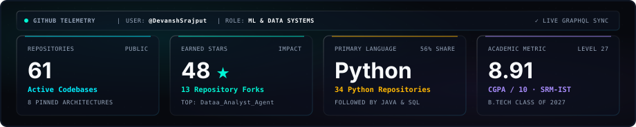
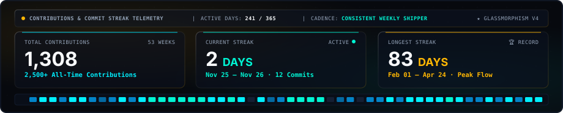

<!-- ========================================================================= -->
<!--                      🎮 HUD // HERO DISPLAY SCREEN                        -->
<!-- ========================================================================= -->

 

<!-- DYNAMIC TYPING TELEMETRY -->

---

> *"Ship real things. Never claim tools without GitHub commit evidence."*  
> **ML Systems &amp; Data Analytics Engineer** &#183; SRM-IST Class of '27 (`CGPA 8.91`) &#183; Ex-Research Intern @ **IIT (ISM) Dhanbad** &#183; **Amazon ML '25**

---

<!-- ========================================================================= -->
<!--                      💻 FEATURED ARCHITECTURES                            -->
<!-- ========================================================================= -->

## 💻 Featured Architectures

---

<!-- ========================================================================= -->
<!--                      📊 TELEMETRY & STREAKS (GLASSMORPHISM)               -->
<!-- ========================================================================= -->

## 📊 Telemetry &amp; Streaks

  

---

<!-- ========================================================================= -->
<!--                      🏙️ CONTRIBUTION SKYLINE (3D ISOMETRIC)              -->
<!-- ========================================================================= -->

## 🏙️ 3D Contribution Skyline

<picture>
  <source media="(prefers-color-scheme: dark)" srcset="./profile-3d-contrib/profile-night-view.svg" />
  <source media="(prefers-color-scheme: light)" srcset="./profile-3d-contrib/profile-green-animate.svg" />
  
</picture>

---

<!-- ========================================================================= -->
<!--                      📬 CONNECT                                           -->
<!-- ========================================================================= -->

## 📬 Connect

&nbsp;

&nbsp;

&nbsp;

  

---

  <code>SYSTEM: OPERATIONAL</code> &nbsp;&#183;&nbsp; <b>Devansh Singh Rajput</b> &nbsp;&#183;&nbsp; Level 27 (Class of '27) &nbsp;&#183;&nbsp; Built for the Next Frontier

